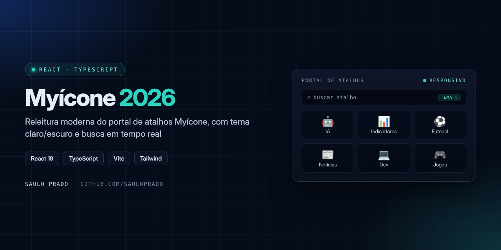
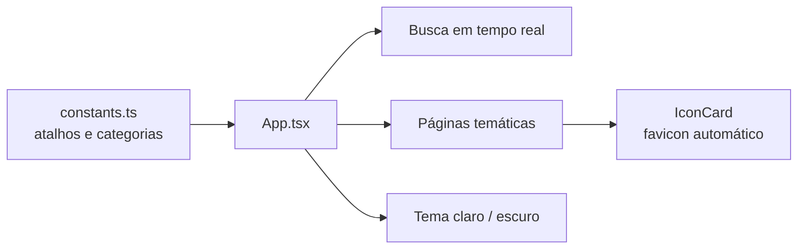

<p align="center">

</p>

<h1 align="center">Myícone 2026</h1>
<p align="center"><i>Releitura moderna e responsiva do clássico portal de atalhos Myícone</i></p>

<p align="center">


</p>

## Sumário

- [Sobre](#sobre)
- [Funcionalidades](#funcionalidades)
- [Páginas](#páginas)
- [Tecnologias](#tecnologias)
- [Como executar](#como-executar)
- [Deploy](#deploy)
- [Estrutura do repositório](#estrutura-do-repositório)
- [Autor](#autor)

## Sobre

O **Myícone** nasceu em 2016 como um portal de atalhos para os sites mais usados da internet brasileira. A versão **2026** é uma releitura completa com **React**, **TypeScript** e **Vite**, mantendo a proposta original: acesso rápido, visual e organizado aos principais serviços da web, em qualquer tela.

## Funcionalidades

- Layout responsivo para celular, tablet e desktop
- Tema claro e escuro com preferência salva no navegador
- Busca de atalhos em tempo real
- Cards com favicon automático a partir do domínio
- Navegação por páginas temáticas e coleções
- Animações suaves de entrada

## Páginas

| Página | Conteúdo |
| --- | --- |
| **Início** | Seleção principal de atalhos da web |
| **IA** | Ferramentas de IA globais e IAs chinesas |
| **Produtividade** | Organização, design e colaboração |
| **Dev** | Referências de Python, frontend, banco de dados, backend e README |
| **Jogos** | Games, plataformas e streaming |
| **Indicadores** | Finanças, clima e serviços úteis |
| **Futebol** | Clubes do Brasil, Europa e seleções |
| **Comunicação** | Jornais do Brasil por estado e portais internacionais |
| **Sobre** | Contexto do projeto |



## Tecnologias

| Tecnologia | Uso |
| --- | --- |
| React 19 | Interface e componentes |
| TypeScript | Tipagem dos atalhos e componentes |
| Vite 6 | Ambiente de desenvolvimento e build |
| Tailwind CSS (PostCSS) | Estilos utilitários e tema |
| Lucide React | Ícones da interface |
| GitHub Actions | Deploy automático para o GitHub Pages |

## Como executar

Requisitos: **Node.js 20+** e npm ou pnpm.

```bash
npm install
npm run dev
```

Acesse `http://localhost:3000`.

<details>
<summary>Usando pnpm</summary>

```bash
corepack pnpm install
corepack pnpm dev
```
</details>

## Deploy

```bash
npm run build     # gera a pasta dist/
npm run preview   # confere o build localmente
```

| Destino | Como publicar |
| --- | --- |
| GitHub Pages | Workflow em `.github/workflows/deploy-pages.yml` (fonte de deploy: **GitHub Actions**). O `base` do Vite é ajustado automaticamente para o nome do repositório. |
| Vercel / Netlify | Publicar a pasta `dist/` |
| Hospedagem tradicional | Enviar o conteúdo de `dist/` para `public_html`, `www` ou `htdocs` |

## Estrutura do repositório

```text
Myicone2026/
├── .github/workflows/deploy-pages.yml
├── assets/capa.png
├── src/
│   ├── components/
│   │   ├── IconCard.tsx
│   │   └── ResponsibilityFooter.tsx
│   ├── App.tsx
│   ├── constants.ts
│   ├── types.ts
│   ├── index.css
│   └── main.tsx
├── index.html
├── package.json
├── tailwind.config.js
├── postcss.config.js
├── tsconfig.json
└── vite.config.ts
```

## Autor

**Saulo Prado** · Analista de Sistemas · Gestão de Ativos de TI, orçamento, automação e dashboards

[](https://www.linkedin.com/in/saulo-prado-ab4a0b96/)
[](https://github.com/sauloprado)
